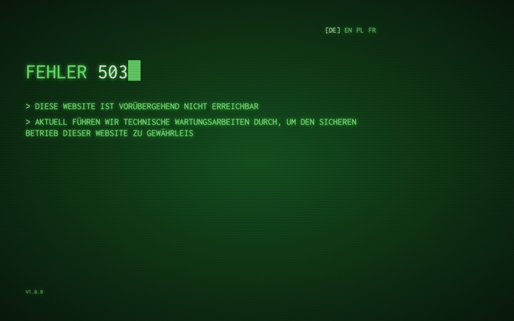
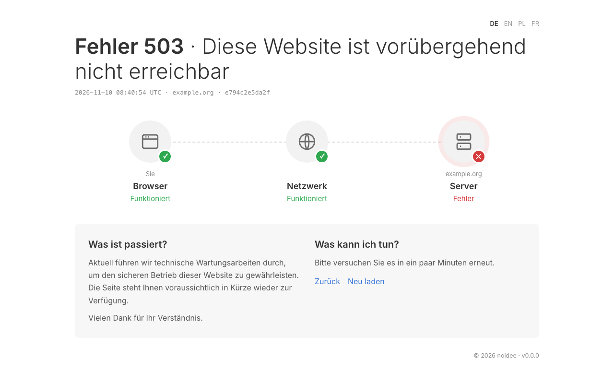
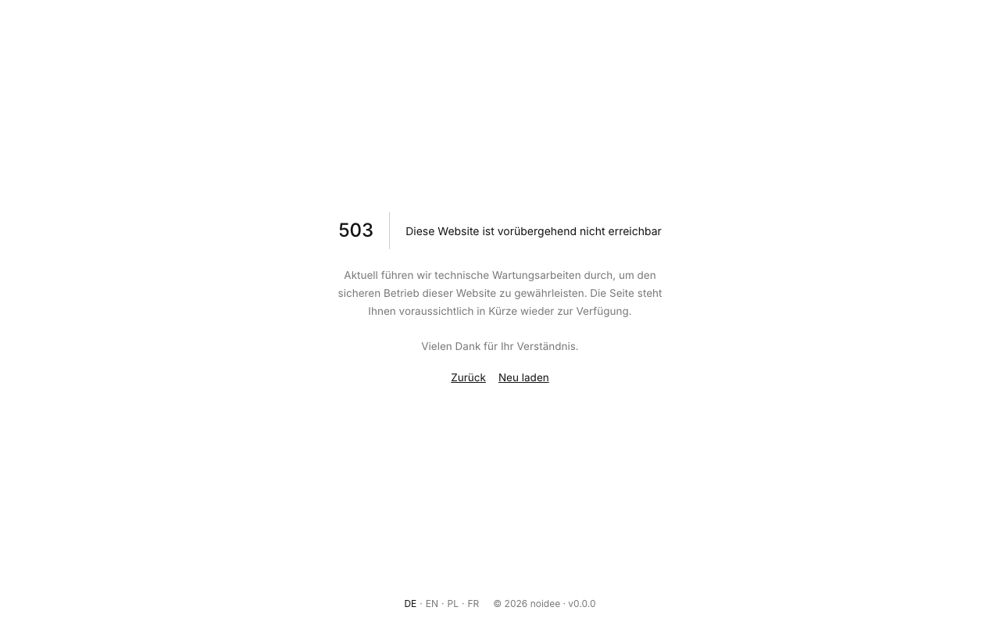

# error-pages

[](https://github.com/NoiXdev/error-pages/actions/workflows/ci.yaml)
[](https://hub.docker.com/r/noixdev/error-pages)
[](LICENSE)

Friendly, fast and accessible error pages for your websites and services. One tiny
container serves a page for every common HTTP error plus a maintenance page, in five
themes and four languages, and it needs no setup to look good.

| Glass | Terminal | Classic |
| --- | --- | --- |
|  |  |  |

| Status | Clean |
| --- | --- |
|  |  |

## Features

- Pages for 400, 401, 403, 404, 405, 407, 408, 409, 410, 411, 412, 413, 416, 418, 429,
  500, 502, 503, 504 and 505, a maintenance page, and a generic page for any other
  4xx or 5xx code.
- Five themes: `glass`, `terminal`, `classic`, `status` and `clean`.
- Four languages: German, English, Polish and French. The language is detected from
  `?lang=`, the browser's `Accept-Language` header or the visitor's saved choice.
- Maintenance mode that you switch on and off at runtime, with an optional end time.
- Answers with JSON or plain text when the client asks for it, so API consumers get a
  readable error too.
- Optional request details (time, host, request ID) and your own footer links and
  copyright line.
- No third-party requests, no cookies, no tracking. Pages work without JavaScript, on
  screens from 320 px wide, and respect `prefers-reduced-motion`.
- Every page is self-contained: styles, fonts and scripts travel inside the page, so it
  arrives complete in a single request even when everything behind it is down.
- A strict Content Security Policy, and nothing about your upstream servers is leaked.
- A very small image that runs read-only as a non-root user.

## Quick start

```bash
docker run -p 8080:8080 noixdev/error-pages
```

Then open <http://localhost:8080/502.html>. Any code works: `/404.html`, `/503.html`
and so on. The maintenance page is at `/maintenance.html`.

Add `?lang=de` to pick a language. Choose a theme with the `THEME` variable:

```bash
docker run -p 8080:8080 -e THEME=terminal -e LANGUAGES=en,de noixdev/error-pages
```

## Traefik

Serve error pages for failing backends with the `errors` middleware, and show a 404
page for every request no other router matches:

```yaml
services:
  error-pages:
    image: noixdev/error-pages
    labels:
      - traefik.enable=true

      # Backend errors 502-504 are answered by error-pages.
      - traefik.http.middlewares.ep-errors.errors.status=502-504
      - traefik.http.middlewares.ep-errors.errors.service=error-pages
      - traefik.http.middlewares.ep-errors.errors.query=/{status}.html

      # Catch-all: anything no other router handles gets the 404 page.
      - traefik.http.middlewares.ep-404.replacepath.path=/404.html
      - traefik.http.routers.ep-catchall.rule=HostRegexp(`.+`)
      - traefik.http.routers.ep-catchall.priority=1
      - traefik.http.routers.ep-catchall.middlewares=ep-404
      - traefik.http.services.error-pages.loadbalancer.server.port=8080
```

Attach `ep-errors` to your own routers (`middlewares=ep-errors`) to use it. If your
sites are served over HTTPS only, give the catch-all router your TLS entrypoint and
`tls=true` as well, or it never sees those requests.

Proxies that keep the original path and pass the status in an `X-Code` header (such as
the ingress-nginx custom error backend) work too. A path that names a page, like
`/404.html`, always wins over `X-Code`.

## Maintenance mode

Switch it on and off while the container runs. The examples assume a container named
`error-pages` with a volume on `/data`, where the state is kept:

```bash
docker run -d --name error-pages -p 8080:8080 -v error-pages-data:/data noixdev/error-pages
docker exec error-pages /error-pages maintenance on
docker exec error-pages /error-pages maintenance on --until 2026-12-01T18:00:00Z
docker exec error-pages /error-pages maintenance status
docker exec error-pages /error-pages maintenance off
```

While it is on, every 5xx page is replaced by the maintenance page (status 503). With
`--until` (an RFC 3339 time) visitors see when you expect to be back and a
`Retry-After` header is sent. To start a container in maintenance mode, set
`MAINTENANCE=true`.

Mount a volume on `/data` if the switch should survive a restart:
`docker run --name error-pages -v error-pages-data:/data ...`. With `--read-only` the
volume is required, because the switch writes its state to `/data`.

## Configuration

Everything is configured with environment variables, or with a YAML file named by
`CONFIG_FILE` (environment variables win). The most common ones:

| Variable | Default | Meaning |
| --- | --- | --- |
| `THEME` | `glass` | `glass`, `terminal`, `classic`, `status` or `clean` |
| `LANGUAGES` | `de,en,pl,fr` | Comma-separated languages on offer |
| `DEFAULT_LANGUAGE` | `en` | Used when nothing else matches; must be in `LANGUAGES` |
| `DEFAULT_PAGE` | `404` | Page for requests that name no error code |
| `SEND_SAME_HTTP_CODE` | `true` | Answer with the page's real status code instead of 200 |
| `SHOW_DETAILS` | `true` | Show time, host and request ID |
| `SHOW_FOOTER` / `SHOW_VERSION` | `true` | Show the footer / the version in it |
| `COPYRIGHT_NAME`, `COPYRIGHT_URL` | empty | Copyright line in the footer |
| `LINKS` | empty | Footer links as JSON |
| `MAINTENANCE`, `MAINTENANCE_UNTIL` | off | Start in maintenance mode, optionally until a time |
| `LISTEN` | `:8080` | Address the server listens on |

The full reference, including links, custom texts and every option, is in the
documentation: <https://docs.noix.dev/error-pages/>.

## Contributing

Bug reports, translations and themes are welcome. See [CONTRIBUTING.md](CONTRIBUTING.md)
and the [Code of Conduct](CODE_OF_CONDUCT.md). Report security issues privately, as
described in [SECURITY.md](SECURITY.md).

## Links

- Source: <https://github.com/NoiXdev/error-pages>
- Image: <https://hub.docker.com/r/noixdev/error-pages>
- Documentation: <https://docs.noix.dev/error-pages/>

## Licence

[MIT](LICENSE). Bundled fonts are listed in [THIRD_PARTY_NOTICES.md](THIRD_PARTY_NOTICES.md).
